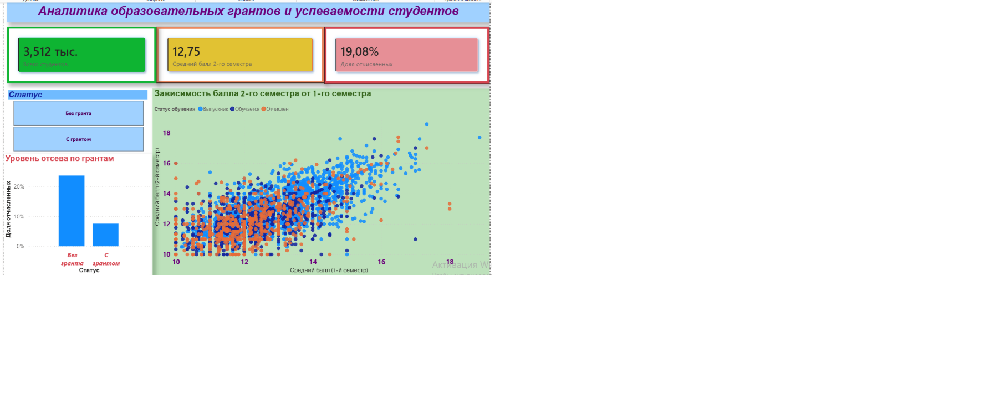

# 🎓 Сквозной проект: Влияние образовательных грантов на успеваемость и отсев студентов

[](https://python.org)
[](https://sqlite.org)
[](https://microsoft.com)
[](LICENSE)

## ⚡ Executive Summary (Главные выводы)
1. **Эффективность грантовой поддержки:** Обладатели образовательных грантов демонстрируют статистически значимо более высокий итоговый балл (**12.86** против **12.55** на платном отделении, $p < 0.0001$) и существенно более низкий уровень отсева (Dropout Rate).
2. **Точность прогнозирования успеваемости:** Модель линейной регрессии объясняет **45.0%** дисперсии итогового балла во 2-м семестре ($R^2 = 0.450$, средняя ошибка **MAE = 0.79 балла**); главным предиктором выступает оценка за 1-й семестр (коэффициент `+0.619`).
3. **Критическая точка 1-го семестра:** Своевременное закрытие дисциплин в первую сессию (`pass_rate_1st_sem`) и наличие гранта (`+0.034` к итоговому баллу) выступают ключевыми факторами удержания студента до выпуска.

---

## 📑 Оглавление
- [1. Постановка задачи, источник данных и стейкхолдеры](#1-постановка-задачи-источник-данных-и-стейкхолдеры)
- [2. Структура репозитория](#2-структура-репозитория)
- [3. Ключевые этапы и результаты анализа](#3-ключевые-этапы-и-результаты-анализа)
- [4. Интерактивный дашборд](#4-интерактивный-дашборд)
- [5. Рекомендации для учебного заведения (Action Plan)](#5-рекомендации-для-учебного-заведения-action-plan)
- [6. Ограничения исследования (Limitations)](#6-ограничения-исследования-limitations)
- [7. Инструкция по запуску проекта](#7-инструкция-по-запуску-проекта)

---

## 1. Постановка задачи, источник данных и стейкхолдеры
* **Стейкхолдер:** Проректор по учебной работе / Руководитель стипендиального фонда.
* **Бизнес-проблема:** Высокий процент отсева студентов на первом курсе и необходимость оценки окупаемости грантовых программ.
* **Цель исследования:** Оценить влияние грантов на удержание (Retention) и успеваемость, построить прогнозную модель балла и проверить статистическую значимость различий между группами.
* **Исследовательские вопросы:**
  1. Как отличается доля отчислений (Dropout Rate) и конверсия в выпуск (Graduation Rate) у студентов с грантом и без гранта?
  2. Какие академические и демографические факторы сильнее всего влияют на итоговый балл 2-го семестра?
  3. Является ли разница в медианной успеваемости между грантниками и платниками статистически значимой?
* **Источник и описание данных:** Открытый датасет [Predict Students' Dropout and Academic Success (Kaggle)](https://www.kaggle.com/datasets/adilshamim8/predict-students-dropout-and-academic-success/data
) (идентификатор для поиска на платформе: `adilshamim8/predict-students-dropout-and-academic-success`). Выборка содержит данные о `4 424` студентах бакалавриата и включает баллы при поступлении, наличие гранта, платежную дисциплину, результаты 1-го и 2-го семестров и итоговый статус обучения (`Graduate`, `Dropout`, `Enrolled`).

---

## 2. Структура репозитория
* `education_analysis.ipynb` — полный код исследования (SQL-выгрузка, изучение структуры, очистка, EDA, образовательные KPI, линейная регрессия, U-тест).
* `extract_education.sql` — SQL-запрос с использованием CTE и оконных функций (`AVG(...) OVER`).
* `education_dashboard.pbix` — исходный интерактивный файл дашборда Power BI.
* `dashboard_preview.png` — скриншот финального дашборда.
* `requirements.txt` — список зависимостей с версиями библиотек.
* `.gitignore` и `LICENSE` — конфигурация репозитория и лицензия MIT.

---

## 3. Ключевые этапы и результаты анализа
* **SQL-выгрузка и обогащение признаков:** В запросе `extract_education.sql` с помощью CTE (`WITH student_base AS ...`) отфильтрованы корректные записи с положительным вступительным баллом, рассчитана доля закрытых дисциплин в 1-м семестре (`pass_rate_1st_sem`), а с помощью оконной функции (`AVG(grade_2nd_sem) OVER(PARTITION BY course)`) вычислен средний балл по каждой образовательной программе.
* **Изучение и очистка данных:** Проверены типы столбцов и отсутствие пропусков (`isna().sum()`). Из `4 424` записей исключены студенты с нулевыми оценками за семестры (бросившие учебу до первой сессии); для анализа успеваемости сохранено **79.4%** данных (`3 512` студентов).
* **Модель прогнозирования (Linear Regression):** Точность на тестовой выборке **$R^2 = 0.450$**, средняя абсолютная ошибка **MAE = 0.79 балла**. Наибольший вклад в прогноз вносит оценка 1-го семестра (`+0.619`), наличие гранта (`+0.034`) и доля закрытых предметов в 1-м семестре (`+0.011`).
* **Проверка гипотез:** По результатам одностороннего U-теста Манна-Уитни медианный балл грантников (**12.86**) статистически значимо выше, чем у студентов без гранта (**12.55**), `p-value < 0.0001` (отвергаем нулевую гипотезу).

---

## 4. Интерактивный дашборд



📥 **[Скачать исходный файл дашборда Power BI (.pbix)](education_dashboard.pbix)** *(открывается в бесплатной программе Power BI Desktop)*

---

## 5. Рекомендации для учебного заведения (Action Plan)
1. **Система раннего предупреждения (Early Warning):** Внедрить автоматический мониторинг закрытия дисциплин в 1-м семестре и назначать академических тьюторов студентам, закрывшим менее 70% предметов.
2. **Расширение программы микро-грантов:** Ввести поощрительные частичные гранты для студентов платного отделения, показавших высокий средний балл в 1-м семестре — это снизит отток контингента и окупится за счет сохранения студентов до выпуска.
3. **Контроль платежной дисциплины:** Настроить напоминания и гибкую рассрочку оплаты обучения для студентов с высокими баллами, имеющих временные задолженности (`fees_up_to_date`), чтобы предотвратить их отчисление по финансовым причинам.

---

## 6. Ограничения исследования (Limitations)
* **Исключение досрочного отсева:** Из регрессионного анализа и сравнения баллов исключены 912 студентов (20.6%) с нулевыми оценками, покинувших вуз до сдачи первой сессии (их отток требует отдельного качественного исследования).
* **Отсутствие данных о размере гранта:** В датасете наличие гранта представлено бинарным признаком (`1/0`) без детализации суммы покрытия обучения и размера ежемесячной стипендии.
* **Специфика учебного заведения:** Данные собраны по одному европейскому вузу, поэтому при переносе выводов на другие университеты требуется калибровка пороговых значений баллов.

---

## 7. Инструкция по запуску проекта
1. Склонируйте репозиторий или скачайте архив с файлами проекта.
2. Скачайте исходный датасет с [Kaggle (Predict Students' Dropout and Academic Success)](https://www.kaggle.com/datasets/adilshamim8/predict-students-dropout-and-academic-success/data) (идентификатор: `adilshamim8/predict-students-dropout-and-academic-success`), переименуйте CSV-файл в `students_data.csv` и поместите его в папку `data/`.
3. Установите необходимые библиотеки:
   ```bash
   pip install -r requirements.txt
   ```
4. Откройте файл `education_analysis.ipynb` в Jupyter Notebook и выполните все ячейки последовательно (`Kernel -> Restart & Run All`).
5. Для просмотра интерактивного дашборда откройте файл `education_dashboard.pbix` в Power BI Desktop.

